<div align="center">

# Scam Gym

**Practise against an AI scammer before you meet a real one.**

A free, installable web app in Bangla and English that trains people to resist online fraud by letting them feel the pressure first, in a safe place.

[**Live app**](https://scam-gym-blush.vercel.app) · [Slide deck (PDF)](docs/Scam-Gym-Deck.pdf) · [Demo video](https://youtu.be/yMobvVwv208) · [How it works](#architecture) · [Run it](#run-it)

Built for the **Ostad Presents YUNet AIgnite Buildathon 2026** · individual entry · B2C web app

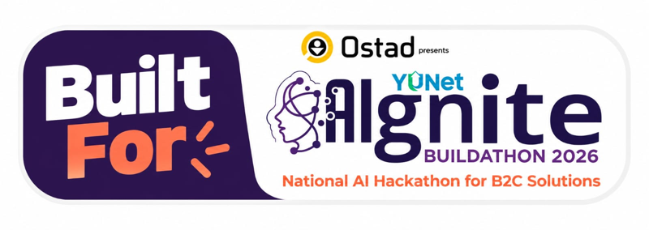

</div>

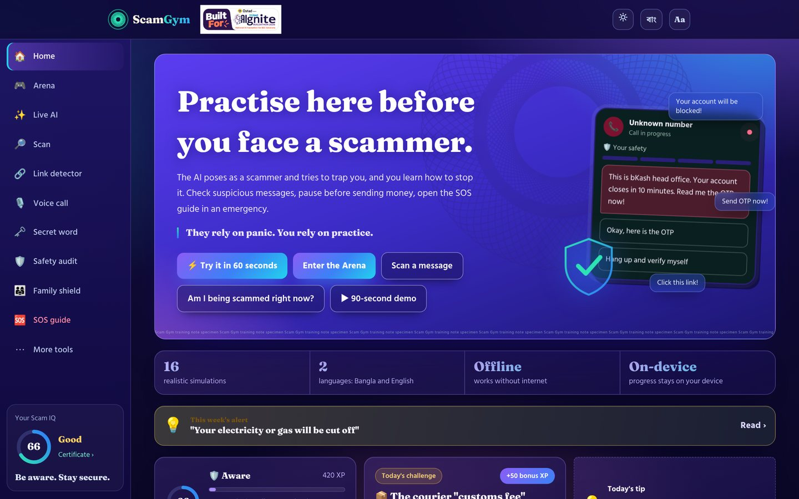

## The problem

Online fraud in Bangladesh runs on a few repeating moves: a caller who "works for bKash" and wants your OTP, a job that needs a registration fee, a relative on a new number who needs money today. People do not fall for them because they lack information. They fall because they meet each trap for the first time under pressure. Posters explain what scams look like, but they never let you feel the urgency.

## The idea

Scam Gym is a training gym. You face a scammer in a safe place, make the mistake there where it costs nothing, and see exactly which manipulation tactic fooled you. Every choice is safe, risky or fatal, and a coach explains why. Over time the habit becomes: pause, verify, hang up.

## Where AI is used

| Job | How |
|---|---|
| **Role-play** | Gemini plays the scammer in open conversation across five personas (fake customer care call, fake job offer, relative on a new number, double-income investment, police or SIM-block threat). It writes fresh messages every run. |
| **Grading** | Gemini judges each reply you type as safe, risky or fatal and explains why, with a safe reply to try next time. |
| **Message and screenshot analysis** | A rule-based scanner runs on the device. An optional Gemini pass gives a second opinion on pasted text or a screenshot, and says when it is unsure. |
| **Guard rails** | The key stays on a server function. Input is length-capped and rate-limited per IP. Output must be valid JSON. User text is treated as data, not instructions. The persona never invents real numbers or links. |
| **Fallback** | With no key or no network, an on-device engine takes over, so the app still teaches. |

## What is in it

<table>
<tr>
<td width="50%">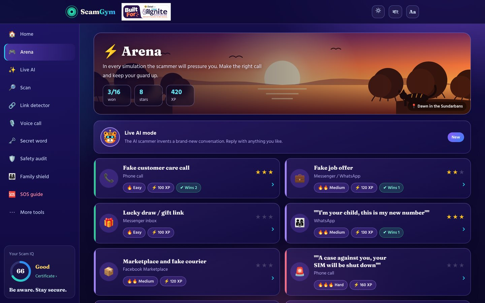<br><b>Arena</b>: 16 branching simulations, each message tagged with its manipulation tactic.</td>
<td width="50%">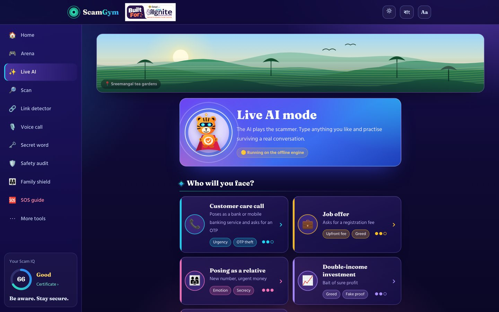<br><b>Live AI</b>: five personas, every reply graded.</td>
</tr>
<tr>
<td>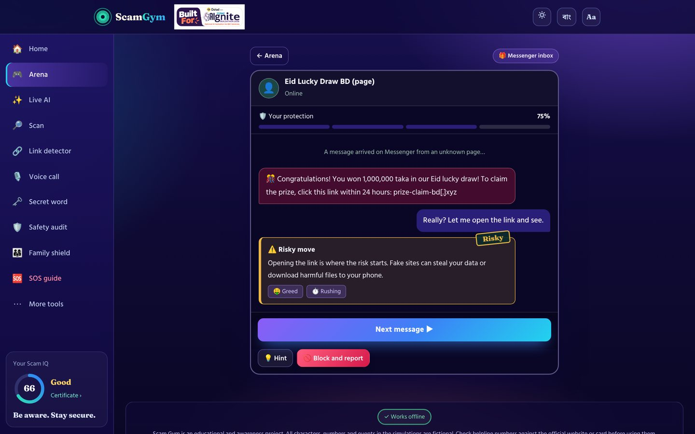<br><b>Simulation</b>: protection meter, coach feedback, tactic chips.</td>
<td>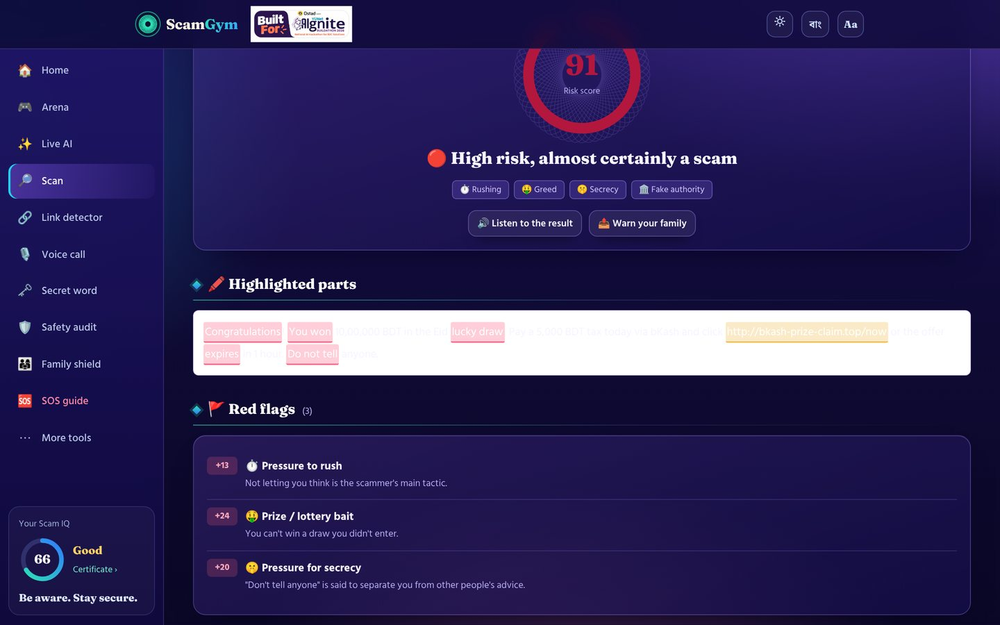<br><b>Scanner</b>: red flags highlighted and explained in Bangla and English.</td>
</tr>
<tr>
<td>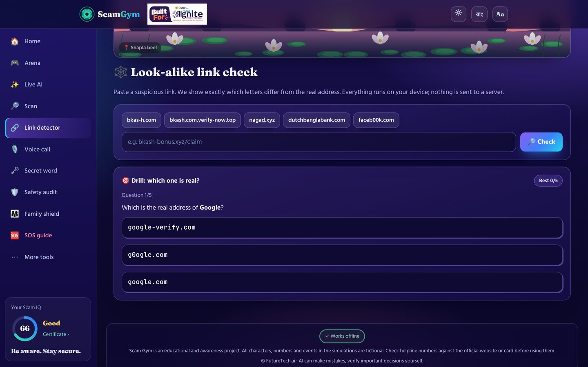<br><b>Look-alike links</b>: letter-by-letter diff against the real address.</td>
<td>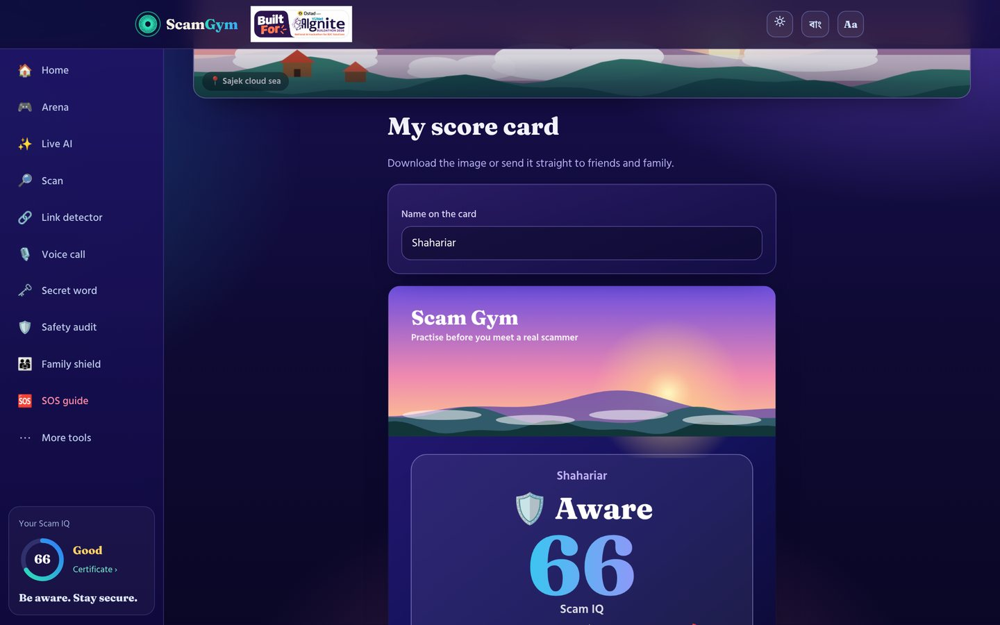<br><b>Score card</b>: shareable image with Scam IQ and rank.</td>
</tr>
<tr>
<td>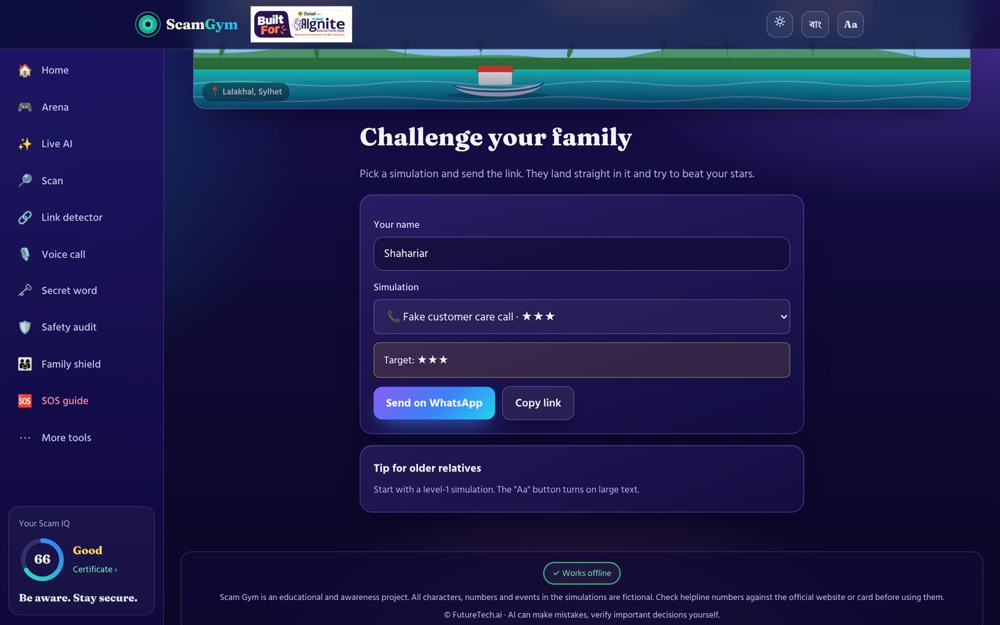<br><b>Family challenge</b>: a link that opens straight into a simulation.</td>
<td>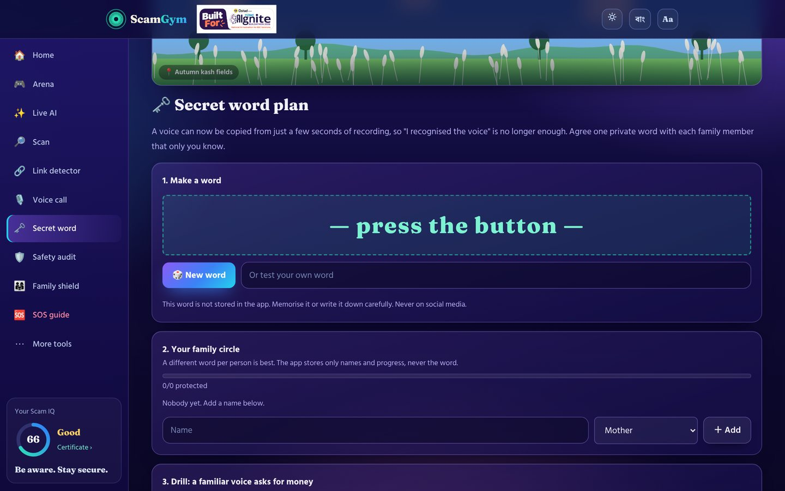<br><b>Secret word plan</b>: a private family word against AI voice cloning.</td>
</tr>
</table>

Also: voice call (answer a phone-style scammer by voice or typing, captions always on), Quick Check, 10-minute pause, safety audit, SOS guide with complaint drafts, family shield, weekly scam alert, weakness radar, certificate, XP, ranks, badges, streaks, backup and restore of progress, emergency card, large-text mode, and an installable PWA that works offline.

Fourteen Bangladeshi landscapes (Sundarbans, Sreemangal tea gardens, Cox's Bazar, St Martin's Island, Kaptai Lake, shapla beel, autumn kash fields, monsoon paddy fields, Sajek, Ratargul, Jaflong, Lalakhal, Bandarban) are drawn as original SVG, one banner per page.

## Architecture

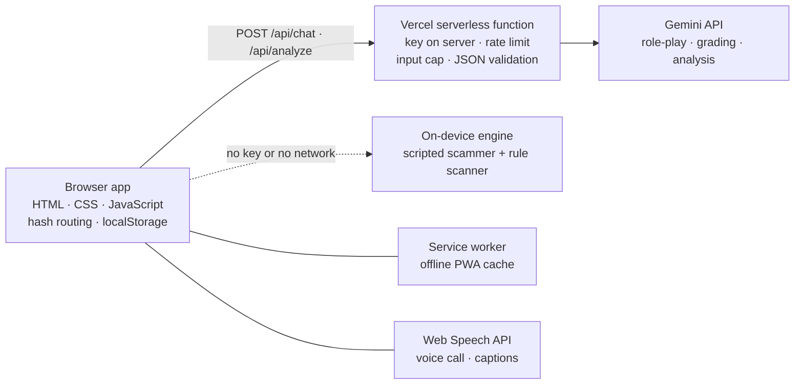

- Static front end: vanilla HTML, CSS and JavaScript, hash routing, `localStorage` for progress. No build step.
- `scanner.js`: weighted regex rules, link analysis, highlighting. Runs entirely on the device.
- `features.js` to `features4.js`: look-alike checker, weekly alerts, secret word plan, voice call, demo tour, offline pack, score card, family challenge. They register through `SG.extend` and write Bangla and English side by side.
- `data.js`, `data2.js`, `data3.js`: simulations, spot-the-scam cards, library, helplines. All numbers, links and names are fictional.
- `scenes.js`: the landscape banners.
- `en.js`: English overlay applied at render time, so Bangla stays the source of truth.
- `api/chat.js`, `api/analyze.js`: Vercel serverless functions calling Gemini.
- `sw.js`, `manifest.webmanifest`: offline PWA.
- Fonts (Fraunces, Noto Serif Bengali, Hind Siliguri; SIL OFL) are self-hosted in `assets/fonts`, so the look is identical offline.

Everything except the Gemini features works with no server and no key. Voice input needs a browser with the Web Speech API (Chrome or Edge); other browsers fall back to typing.

## Demo

[Watch the 2-minute demo video on YouTube](https://youtu.be/yMobvVwv208)

Open the live app and press **Try it in 60 seconds** on the home page, or play the 90-second guided tour at `#/tour`. Add `?lang=en` for English.

| Phone | Safety audit |
|---|---|
| 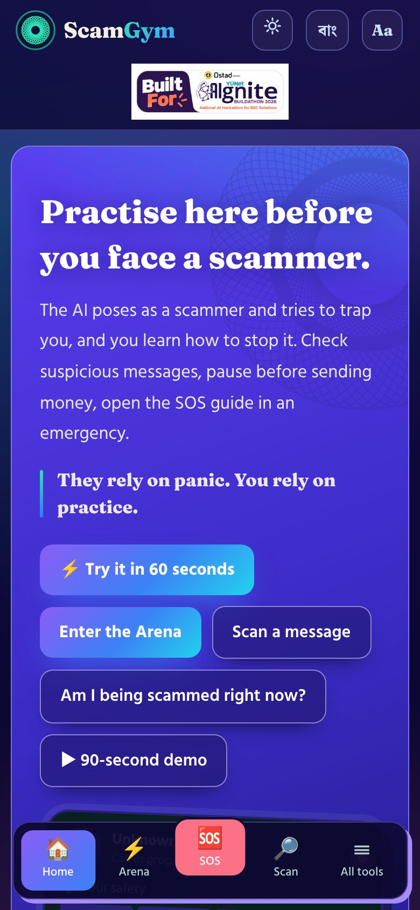 | 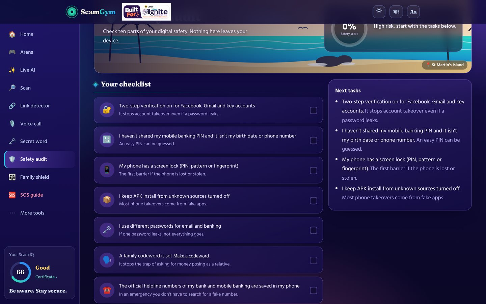 |

## Run it

```bash
# static only (no AI features)
python3 -m http.server 8080      # then open http://localhost:8080

# with AI features
npm i -g vercel
GEMINI_API_KEY=your_key vercel dev
```

Deploy to Vercel (framework: Other) and set `GEMINI_API_KEY`. Optional: `GEMINI_MODEL` (default `gemini-2.5-flash`).

## Safety and honesty

- Educational project. Simulations are fictional and the scammer never receives real personal data.
- Helplines are listed for convenience; verify numbers on the provider's official site or card before relying on them.
- The scanner is a rule-based aid, not a guarantee. AI output can be wrong, and the interface says so.
- Not legal or financial advice.

## Checks

```bash
node --check app.js features.js features2.js features3.js features4.js data.js data2.js data3.js en.js scanner.js scenes.js api/*.js
```

Scanner behaviour was checked against scam and genuine samples (genuine OTP notices score near zero). Every route and simulation was walked in jsdom in both languages.

## Author

Built by Shahariar, founder of FutureTech.ai. More projects: [github.com/shahariar-ai](https://github.com/shahariar-ai) · [github.com/shahriarsharif406](https://github.com/shahriarsharif406)

Slide deck: [docs/Scam-Gym-Deck.pdf](docs/Scam-Gym-Deck.pdf)

© FutureTech.ai · MIT License
