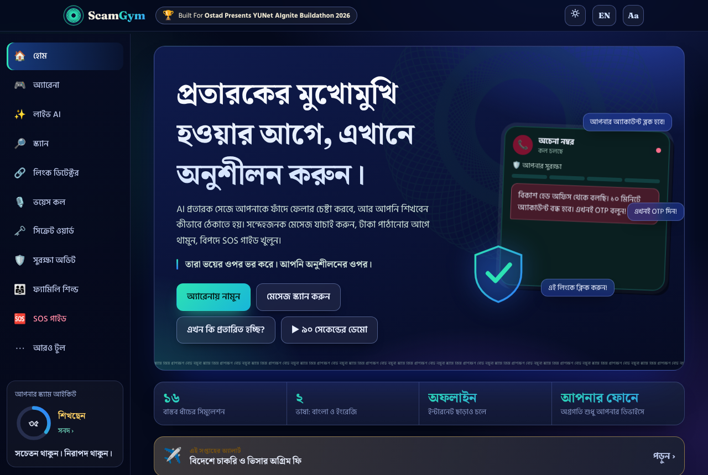
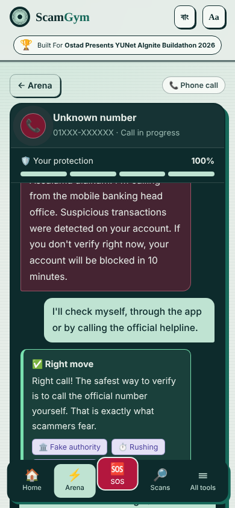
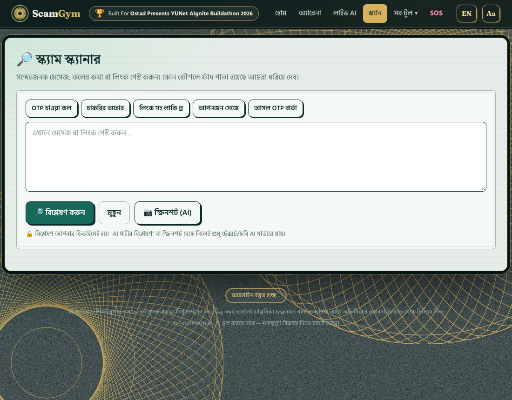
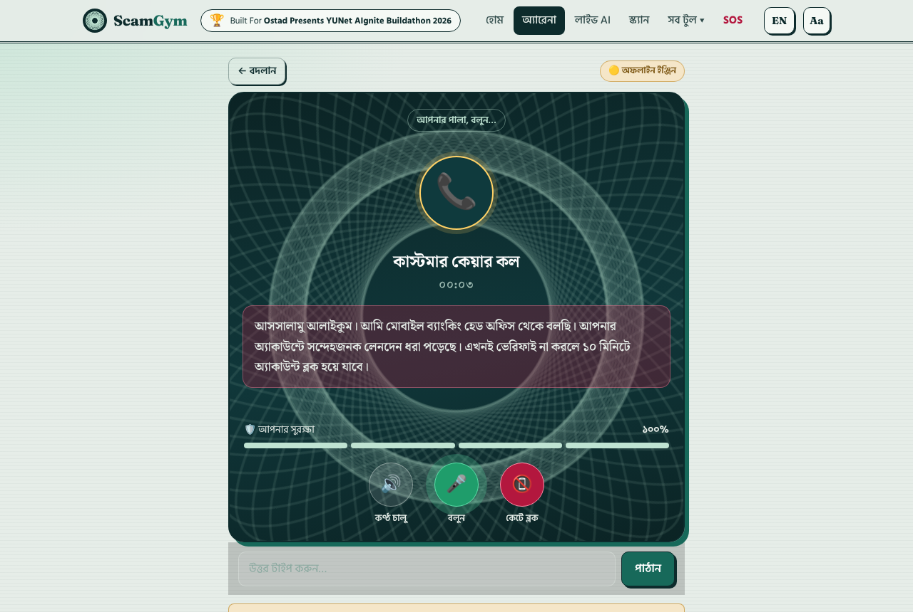
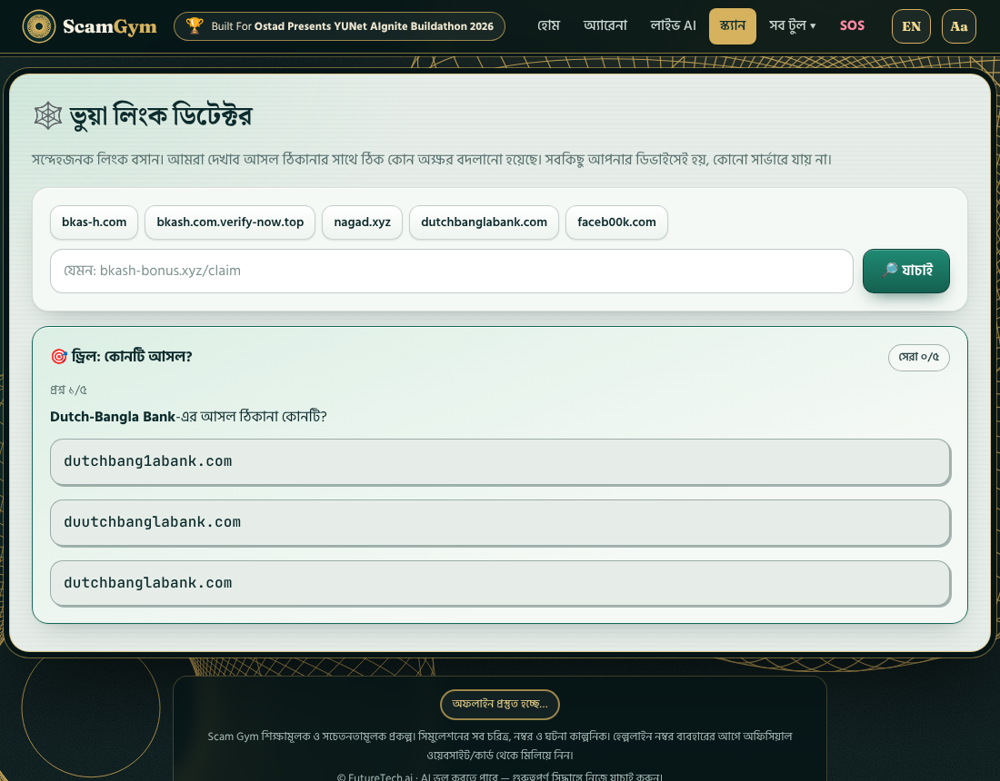
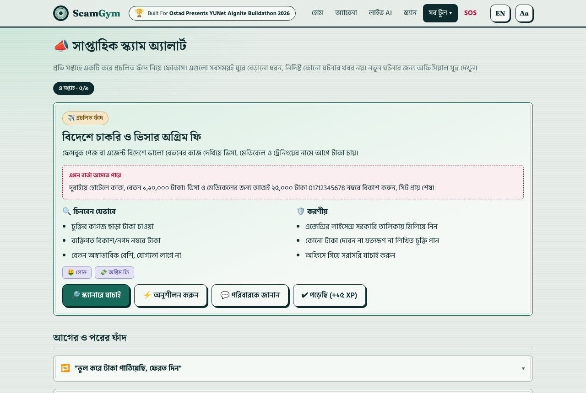
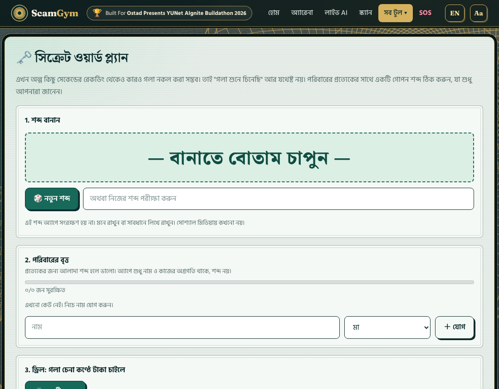

# Scam Gym

**A training gym for scams. Practise against an AI scammer before you meet a real one.**

Built for the *Ostad Presents YUNet AIgnite Buildathon 2026* · individual entry · B2C web app · Bangla and English.

Online fraud in Bangladesh runs on a few repeating moves: a caller who "works for bKash" and wants your OTP, a job that needs a registration fee, a relative on a new number who needs money today. People fall for them because they meet each trap for the first time under pressure. Scam Gym lets them meet it first in a safe place, make the mistake there, and see exactly which tactic fooled them.



## What it does

| | |
|---|---|
| **Arena** | Ten branching simulations (fake customer care, fake jobs, lucky-draw links, family impersonation, marketplace and courier fraud, fake police, loan-app blackmail, romance investment, fake delivery, a hacked friend). Every message is tagged with the manipulation tactic it uses. |
| **Voice call** | The scammer speaks on a phone-style call (browser speech synthesis) and you answer out loud with the microphone, or type. Captions and a transcript are always shown, so it also works without voice support. |
| **Live AI** | Gemini plays the scammer in an open conversation. You type anything; a coach grades each reply as safe, risky or fatal. Falls back to a scripted engine when offline. |
| **Scanner** | Paste a message or link. A rule engine (Bangla and English) highlights red flags, explains each one, and separates what looks suspicious from what could not be checked, and analyses links (look-alike brands, shorteners, bad TLDs, IP hosts, punycode). Optional Gemini second opinion and screenshot analysis. |
| **Look-alike link check** | Paste a link and see the owner name split from the subdomain, plus a letter-by-letter diff against the real address (swapped letters, extra words, changed ending, brand hidden in a subdomain). Includes a "which one is real?" drill. Runs on the device. |
| **Quick Check** | Six questions to find out whether you are being scammed right now, with a direct route to SOS if money already moved. |
| **10-Minute Pause** | A cooling-off timer and checklist for before you send money. Scammers need you to hurry. |
| **Safety Audit** | Ten checks of your digital hygiene with a score and next actions. |
| **SOS** | First-15-minutes guide, helplines, and a generator for complaint drafts (police, mobile banking provider, bank). |
| **Family Shield** | A secret family codeword, a shareable rules card, and a large-text mode for parents. |
| **Secret word plan** | Make a private word per family member against AI voice cloning, track who has been told and tested, get a 90-day change reminder, and rehearse a cloned-voice call. The app never stores the word itself. |
| **Weekly scam alert** | One common trap in focus each week with a sample message, how to spot it, what to do, and one tap to scan or practise it. These are recurring patterns, not news of specific incidents. |
| **Demo tour** | A 12-step guided tour (about 90 seconds, `#/tour` or `?tour=1`) that plays through the app for first-time visitors and restores your progress afterwards. |
| **Weakness radar** | Tracks which tactics you actually fall for and recommends the simulation that trains them. |
| **Certificate** | A downloadable training certificate with your Scam IQ. |
| **Challenge links** | Share a result as a link; a friend plays the same scenario and tries to beat your stars. |

Also: XP, ranks, badges, daily challenge, streaks, text-to-speech, installable PWA that works offline.

<p>


</p>






## Design

The interface is a security-printing look: banknote-style paper, ink, guilloche rosettes, double-rule borders and rubber-stamp verdicts, because the product is about telling genuine from counterfeit. The simulator is a dark ink "device" on a light paper page. Type is Noto Serif Bengali and Fraunces for display, Hind Siliguri for text.

## Architecture

- Static front end: vanilla HTML, CSS and JavaScript, hash routing, `localStorage` for progress. No build step.
- `scanner.js`: weighted regex rules, link analysis, highlighting. Runs entirely on the device.
- `features.js`, `features2.js`: look-alike checker, weekly alerts, secret word plan, voice call, demo tour. They register through `SG.extend` and write Bangla and English side by side.
- `data.js`, `data2.js`: simulations, spot-the-scam cards, library, helplines. All numbers, links and names are fictional.
- `en.js`: English overlay applied at render time, so Bangla stays the source of truth.
- `api/chat.js`, `api/analyze.js`: Vercel serverless functions calling Gemini. Input caps, per-IP rate limiting, JSON-only output, prompts hardened against injection. The scammer persona never produces real numbers or URLs.
- `sw.js`, `manifest.webmanifest`: offline PWA.
- Fonts (Fraunces, Noto Serif Bengali, Hind Siliguri; SIL OFL) are self-hosted in `assets/fonts`, so the look is identical offline.

Everything except the Gemini features works with no server and no key. Voice input needs a browser with the Web Speech API (Chrome or Edge); other browsers fall back to typing.

## Run it

```bash
# static only (no AI features)
python3 -m http.server 8080      # then open http://localhost:8080

# with AI features
npm i -g vercel
GEMINI_API_KEY=your_key vercel dev
```

Deploy to Vercel (framework: Other) and set `GEMINI_API_KEY`. Optional: `GEMINI_MODEL` (default `gemini-2.5-flash`).

Open with `?lang=en` for English, or use the language button in the header.

## Official sticker

The buildathon sticker is loaded from `assets/sticker.png` and shown in the header. If the file is missing, a text badge is shown instead.

## Safety and honesty

- Educational project. Simulations are fictional and the scammer never receives real personal data.
- Helplines are listed for convenience; verify numbers on the provider's official site or card before relying on them.
- The scanner is a rule-based aid, not a guarantee. AI output can be wrong, and the interface says so.
- Not legal or financial advice.

## Tests

```bash
node --check app.js features.js features2.js data.js data2.js en.js scanner.js api/*.js
```

Scanner behaviour was checked against scam and genuine samples (genuine OTP notices score near zero), and every route and simulation was walked in jsdom.

© FutureTech.ai · MIT License

## Offline pack

| Feature | What it does |
|---|---|
| Offline status and install | Footer pill shows whether the app is cached; a banner appears when the connection drops; one-tap install to the home screen |
| Progress backup and restore | Exports XP, badges, scores and family names to a JSON file and restores it on another phone. Validated on import. The secret word is never written to the file |
| Emergency card | One page of steps and helplines with an optional trusted contact (kept on the device). Save as PNG or print |
| 6 more simulations | Courier customs fee, power disconnection threat, used-phone advance payment, remittance bonus, QR "to receive money", SIM/NID update. 16 in total, fully bilingual and playable offline |
